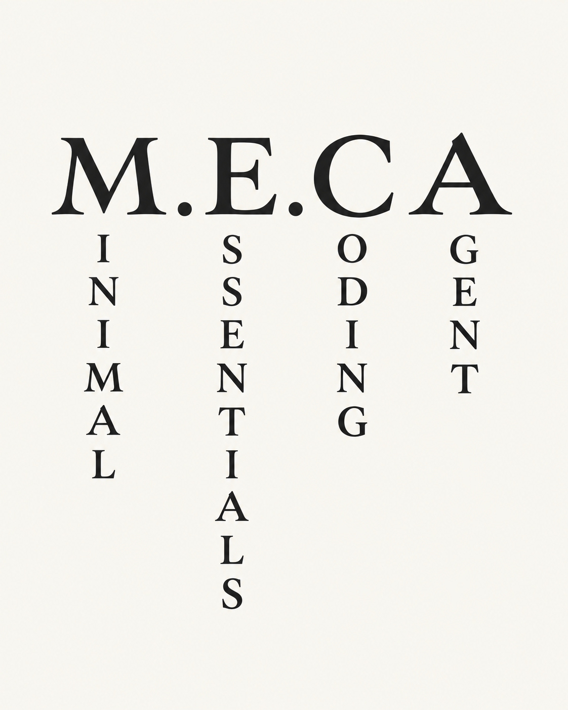

<div align="center">



*A coding agent with just the essentials.*

[설치](#설치) · [Provider](#지원-provider) · [사용법](#사용법) · [서버](#서버) · [설정](#설정) · [문서](#문서)

</div>

**M.E.CA — Minimal Essentials Coding Agent**는 TUI·CLI·서버로 실행하는 Go 코딩 에이전트입니다. 선택한 모델로 코드 작성·수정·검증을 수행하며, 세 실행 방식은 같은 도구·대화·승인 정책을 사용합니다.

- Ollama, vLLM, SGLang, LM Studio, LiteLLM, OpenRouter, OpenAI, Claude, Gemini 연결
- 스트리밍 응답·Thinking, Markdown과 줄 단위 diff
- 파일·셸 도구, 비전 모델의 이미지 붙여넣기·보기, 오래 실행되는 명령의 조회·대기·취소
- 파일 선택·분할/전체화면 Markdown 뷰어
- 로컬 대화 저장·압축·재개, 작업 중 방향 수정과 후속 요청 예약
- 선택적 팀 모드: 공유 프로젝트에서 최대 8개 세션의 자율 협업과 공용 대화
- 프로세스 메모리 사용량·실제 입력/출력 토큰·TPS, OpenRouter의 보고 비용 표시
- 선택형 SSE·WebSocket·gRPC 서버 API와 재접속·승인·취소 제어
- 공통 SKILL.md 스킬: `!skills` 조회·미리보기, `#스킬명` 지정과 에이전트의 자율 탐색
- 스킬 읽기 이벤트와 작업 식별자로 연결되는 bounded JSON 운영 로그

## 설치

Linux·WSL과 macOS의 amd64·arm64를 지원합니다. 릴리스 바이너리는 Go 설치 없이 사용할 수 있습니다.

### 최신 릴리스로 설치하기

1. [최신 릴리스](https://github.com/keonho-kim/m.e.ca/releases/latest)에서 운영체제와 CPU에 맞는 `.tar.gz` 파일을 받습니다.
2. 압축을 풀고 터미널에서 압축을 푼 폴더로 이동합니다.
3. 아래 명령으로 설치합니다.

```sh
./meca install
```

설치 후 터미널에서 `meca`를 실행하면 됩니다.

<details>
<summary>설치 상세 안내 — 파일 선택·체크섬·업데이트·소스 빌드·삭제</summary>

### 운영체제와 CPU에 맞는 파일 선택

| 환경 | 파일명의 `<platform>` |
| --- | --- |
| Apple Silicon Mac | `macos_arm64` |
| Intel Mac | `macos_amd64` |
| Linux·WSL — `x86_64` | `linux_amd64` |
| Linux — `aarch64`·`arm64` | `linux_arm64` |

Linux의 CPU 종류는 `uname -m`으로 확인할 수 있습니다.

### 터미널에서 압축 해제하기

다운로드한 폴더에서 실행합니다. `<version>`과 `<platform>`은 받은 파일명으로 바꾸세요.

```sh
mkdir meca-install
tar -xzf "meca_<version>_<platform>.tar.gz" -C meca-install
./meca-install/meca install
```

`~/.local/bin/meca`에 설치하고 필요한 PATH를 등록합니다. 설정·프롬프트·대화는 `~/.meca`에 저장합니다.

### 체크섬 확인 (선택)

파일의 무결성을 확인하려면 같은 릴리스의 `checksums.txt`도 다운로드합니다. 압축을 풀기 전에 아래 명령의 결과를 `checksums.txt`의 동일 파일명 항목과 비교하세요.

```sh
# macOS
shasum -a 256 "meca_<version>_<platform>.tar.gz"

# Linux
sha256sum "meca_<version>_<platform>.tar.gz"
```

### 업데이트

실행 중인 MECA를 종료한 뒤 실행합니다.

```sh
meca upgrade
```

최신 릴리스를 내려받아 검증하고 설치합니다. 설정·모델 연결·대화는 유지하며, 기본 프롬프트는 배포 기본본으로 갱신합니다.

### 소스에서 설치하기

Git과 Go로 소스에서 설치합니다. Go가 없으면 `curl`·`tar`와 `sha256sum` 또는 `shasum`을 사용해 빌드용 Go를 검증하고 임시 다운로드합니다.

```sh
git clone https://github.com/keonho-kim/m.e.ca.git
cd m.e.ca
./install.sh
```

최신 소스로 재설치하려면 저장소에서 실행합니다.

```sh
git pull --ff-only
./install.sh
```

### 빌드만 하기

제품 빌드는 Go 1.27.2 이상, 개발 도구는 Go 1.27.3 이상이 필요합니다. 제품과 도구의 요구 버전은 각각 [go.mod](go.mod)와 [devtools/go.mod](devtools/go.mod)가 소유합니다.

```sh
go build -tags=godbus_no_tcp -trimpath -o bin/meca ./cmd/meca
```

PGO 프로파일 생성과 빌드 비교는 [개발 가이드](docs/development.md#pgo-빌드-측정)를 따릅니다.

설치하려면 `./bin/meca install`을 실행합니다. 공식 빌드와 소스 설치에도 같은 [DBus 전송 정책](docs/configuration.md#linux-자격-증명-전송)을 적용합니다.

### 삭제

```sh
meca uninstall
```

설치한 명령·PATH 등록·`~/.meca` 전체와 MECA가 저장한 OS 인증정보를 삭제합니다. 사용자 프로젝트는 유지합니다.

[설치 옵션·체크섬·업데이트 상세 →](docs/releases.md)

</details>

## 지원 Provider

모델 연결은 TUI의 `!model` 또는 서버의 `setModel`로 설정합니다. Base URL에는 생성 API 경로를 덧붙이지 않습니다.

| Provider | 식별값 | 기본 Base URL | 생성 API |
| --- | --- | --- | --- |
| Ollama | `ollama` | `http://localhost:11434` | Ollama Chat |
| vLLM | `vllm` | `http://localhost:8000/v1` | Chat Completions |
| SGLang | `sglang` | `http://localhost:8000/v1` | Chat Completions |
| LM Studio | `lm-studio` | `http://localhost:1234` | Responses |
| LiteLLM | `litellm` | `http://localhost:4000/v1` | Chat Completions |
| OpenRouter | `openrouter` | `https://openrouter.ai/api/v1` | Chat Completions |
| OpenAI | `openai` | `https://api.openai.com/v1` | Responses |
| Claude | `claude` | `https://api.anthropic.com/v1` | Messages |
| Gemini | `gemini` | `https://generativelanguage.googleapis.com/v1beta` | GenerateContent |

OpenAI·Claude·Gemini는 각 공급자의 API Key가 필요합니다. 인증이 설정된 모델 서버·게이트웨이에는 해당 Key를 사용하며, 인증 없는 로컬 서버에서는 비워 둡니다. 저장한 API Key는 암호화해 보관합니다.

코딩 작업에는 native tool calling을 지원하는 모델·서버 설정이 필요합니다. 이미지 입력과 Thinking 제어는 메타데이터 또는 명시적 검사로 확인합니다. [Provider별 연결·인증·추론 설정 →](docs/model-connections.md)

## 사용법

```sh
meca                  # 현재 프로젝트에서 시작
meca /path/to/project  # 지정한 프로젝트에서 시작
meca resume           # 모든 프로젝트의 이전 대화에서 선택
```

1. `!model`에서 Provider·서버 주소·API Key·모델을 설정합니다. [모델 연결 가이드](docs/model-connections.md)를 참고하세요.
2. 자연어로 작업을 요청합니다. 파일을 참조하려면 `!dir`에서 선택합니다.
3. 응답·도구 결과·diff를 확인하고, 필요하면 작업 중 방향을 수정하거나 중지합니다.

| 명령 | 기능 |
| --- | --- |
| `!model` | 연결·모델·Thinking·추론 강도 설정 |
| `!language` | 화면 언어 선택 |
| `!permission` | 기본 / All Mighty 승인 모드 선택 |
| `!dir [path]` | 파일 탐색·Markdown/Raw 뷰어·요청에 파일 참조 |
| `!new` | 현재 프로젝트에서 새 대화 시작 |
| `!quit` | 작업을 정리하고 종료 |
| `!team` | 현재 대화의 팀 모드 켜기·끄기 |
| `!skills` | 설치한 스킬·출처·진단 조회와 본문 미리보기 |

`!` 뒤에 글자를 입력하면 명령을 검색합니다. 설정 저장·파일 전송 확인에서는 `y`·`Y`로 진행하고, 대문자 `N`으로 취소합니다. 소문자 `n`은 무시합니다.

스킬은 프로젝트 `.agents/skills/`, 개인 `~/.meca/skills/`, 공유 `~/.agents/skills/`에서 찾습니다. 시작·설치 시 `create-skill`·`ui-design`·`backend-design` 기본 스킬을 참고 파일과 함께 생성하며 기존 파일은 보존합니다. `#ui-design`만 호출하면 에이전트가 과업·정보 관계·빈도·위험 등 사용 맥락을 살펴 페이지·레이아웃·컴포넌트·모션을 응용합니다. 목록은 조합·변형할 수 있는 예시이며, 실제 내용에 맞는 구조·강조·문구·상태를 만드는 anti-slop 지침을 설계 전 과정에 적용합니다. Product Design의 맥락·시각적 근거·완전한 작업 흐름·실제 렌더링/상호작용 검토 원칙도 반영합니다. Skeleton Pulse/Shimmer·기본 Blur-up·Step Status와 Hamburger Morph·Side Drawer·Staggered Dropdown의 조합, 색을 맥락에 따라 결정하는 8가지 원칙을 다룹니다. 타이포·형태·밀도·이미지·전체 구성·상호작용·모션을 독립적으로 판단하는 지침과 의도한 표현을 보존하는 anti-slop 사례도 제공합니다. 외부 의존성 없는 HTML/CSS/Vanilla JS 예시는 결재·DB 워크벤치·자료 관리·예약·DB 지식 대화·AI 오피스의 여섯 앱과 예약 대안·캔버스·모션을 포함한 36페이지입니다. 동봉 예시에서 오피스는 문서·슬라이드 도구와 작업면을, Archive는 미니멀리즘·에디토리얼 구성과 역할별 포인트 색을 사용하며 Querydesk는 다크 테마입니다. 참고 지침은 선택 기준과 장단점을 설명하고, 에셋과 그 디자인 기록은 해당 사례만 설명합니다. 실제 프로젝트의 요구와 디자인 시스템이 우선하며 예시의 색·화면 수·파일 구조를 그대로 따를 필요는 없습니다. 결재·DB·지식 대화·오피스는 화면별 디자인 셸이며 실제 DB·AI·승인·문서 편집·내보내기를 구현하지 않습니다. 자료는 앱별·공통·모션·참고 캡처 폴더로 구분하며 Markdown 안내에서 필요한 파일을 직접 선택합니다. 참고 자료는 최대 세 층이며 설명은 파일별 8KiB, 코드·미디어는 1MiB까지 허용하고 512KiB 이하를 권장합니다. 서브커맨드는 없습니다. `#create-skill`은 스킬 작성을 돕고, 에이전트가 설명을 보고 필요한 스킬을 자율적으로 읽을 수도 있습니다. [스킬 형식·도구·범위 →](docs/skills.md)

`#backend-design`은 설계 단계부터 CPU·메모리·저장공간·I/O·네트워크·응답 지연을 고려하도록 안내합니다. SQLite·PostgreSQL·Redis의 역할과 동시성, API·스트리밍·작업 수명, 중앙 로거/에러 계약, 고급 암호화·키 관리, 검색·벡터·메모리 최적화를 부하와 장애 조건에 맞춰 판단합니다. 기본 개발 패턴을 책임·호출 흐름·트랜잭션·자원 소유가 드러나는 일곱 실전 구성으로 확장하고, 네 가상 서비스의 설계안과 예상 비용을 비교합니다. 단일 호출에서 필요한 참고 자료만 탐색합니다. [스킬 본문](internal/config/bootstrap/defaults/backend-design/SKILL.md)과 [조사 출처](internal/config/bootstrap/defaults/backend-design/references/sources.md)를 참고하세요.

| 조작 | 동작 |
| --- | --- |
| `Enter` / `Shift+Enter` | 요청 전송 / 줄바꿈 |
| 작업 중 `Enter` / `Tab` | 다음 판단에 방향 수정 / 완료 후 수행할 요청 예약 |
| `Shift+↑/←` | 마지막 예약 열기·이전 예약 선택 |
| 큐 편집 중 `Shift+↓/→` | 다음 예약 선택 |
| 큐 편집 중 `Enter`·`Tab` / `Esc` | 수정 저장 / 편집 취소 |
| 큐 편집 중 `Ctrl/Cmd+Backspace` | 선택한 예약 삭제 |
| `Esc` | 열린 화면·편집 닫기, 일반 채팅에서는 작업 중지 |
| `Ctrl+O` | 실행 중인 도구·완료 결과 전체 접기·펼치기 |
| 파일 탐색 `Shift+Tab` | 목록 / 요청 입력창 포커스 전환 |
| 파일 목록 `Tab` / `Enter` | 분할 / 전체화면 미리보기 |
| 파일 뷰어 `Shift+R` | Markdown 렌더링 / Raw 원문 전환 |
| 선택 후 `Ctrl/Cmd+C` | 복사 · 선택 없는 `Ctrl+C`는 종료 |

후속 요청은 예약 당시 선택한 파일 경로와 함께 순서대로 실행합니다. 중지·실패 시 남은 요청은 초안으로 복구합니다. 실행 중인 도구와 완료 결과는 기본으로 접혀 있으며 첫 결과 전에도 `Ctrl+O`로 긴 명령과 상세를 펼칩니다. [전체 키맵·파일 탐색·사용량 →](docs/usage.md)

`!team`을 켠 뒤 요청을 보내면 두 에이전트가 같은 프로젝트에서 시작합니다. 바로 진행할 독립 작업에 추가 인원이 필요하면 동료를 초대하거나 이전 세션을 복구합니다. 각 에이전트는 이름과 담당 파일을 공유하며, 대화와 응답은 하나의 화면에 발신자별로 표시합니다. 팀 Thinking은 개인 이력에 보관하고 화면에서는 숨깁니다. 독립 셸 명령은 에이전트별 최대 16개씩 병렬 실행하고 확인된 변경 경로의 충돌을 조율합니다. [팀 모드 →](docs/team.md)

### 승인과 실행 범위

기본 모드는 일반 작업을 자동 실행하고 위험 작업에 승인을 요청합니다. All Mighty는 그 외 승인 대상을 자동 승인하지만, **외부 전송은 모든 모드에서 매번 직접 승인**받습니다. 승인할 수 없는 비대화형 실행에서는 외부 전송을 중단합니다.

프로젝트는 기본 작업 위치이며 OS 격리 경계가 아닙니다. 명령은 호스트 사용자 권한으로 실행합니다. [검사 대상과 보장 범위 →](docs/execution-boundary.md)

### 터미널 없이 실행하기

`!model`에서 연결을 저장한 뒤 사용할 수 있습니다.

```sh
meca --print "README를 검토해줘"
meca /path/to/project --mode json "요청한 파일을 만들어줘"
git diff | meca --print "이 변경을 검토해줘"
meca --diagnose
```

print는 최종 답변, JSON 모드는 순서 있는 이벤트를 출력합니다. [세션 재개·내보내기 →](docs/usage.md#도구-결과와-markdown)

## 서버

서버는 native 선택 대화와 작업별 대화를 소유하며 같은 코어에서 실행합니다. `--concurrency N`은 기본 1이며 양의 정수로 설정합니다. 제품이 정한 고정 상한은 없고, 메모리·입력·연결 예산은 별도로 적용합니다. 같은 세션의 중복 실행은 차단합니다. 저장 형식과 기존 데이터의 열기 제한은 [세션·서버 저장 안내](docs/configuration.md#세션-저장과-복원)를 확인하세요.

```sh
meca --server                            # 기본 SSE
meca /path/to/project --server --protocol socket
meca /path/to/project --server --protocol grpc
meca --server --concurrency 4             # 서로 다른 세션의 작업을 최대 4개 실행
```

기본 주소는 `127.0.0.1:8787`입니다. TTY 없이 프로젝트 하나를 서비스하며 팀 에이전트는 각 작업 안에서 독립 실행합니다. 같은 프로젝트에 대한 변경·셸 실행은 작업 단위로 직렬화해 서로 다른 작업의 파일 효과가 섞이지 않게 합니다.

| `--protocol` | 제어·이벤트 인터페이스 |
| --- | --- |
| `sse` | `POST /v1/command`와 `GET /v1/events` |
| `socket` | `/v1/socket`의 WebSocket 명령·이벤트 |
| `grpc` | Protobuf 계약의 native gRPC·gRPC-Web·Connect |

선택한 전송 방식과 함께 공통 HTTP 제어·이벤트·첨부·작업 승인 경로를 제공합니다. 작업은 서버 프로세스에 속하므로 스트림을 닫아 일시정지해도 계속됩니다. 마지막 커서로 다시 구독하며 안정된 요청 키로 중복 실행을 막습니다.

기본 토큰 파일 `~/.meca/server.token`은 서버 시작 시 준비합니다. HTTP·SSE·RPC는 Bearer 헤더, WebSocket은 첫 프레임으로 인증합니다. `--listen`, `--token-file`, `--tls-cert`, `--tls-key`, `--allow-host`, `--allow-origin`으로 배치를 설정합니다. 외부 바인딩에는 TLS가 필요합니다. [서버 실행·인증·API 계약 →](docs/server.md)

자체 API는 세션별 모델·설정 변경, provider/model 탐색, 파일 탐색·미리보기·참조 선택, 이미지 업로드·저장 이미지 조회, 작업 목록·승인·취소를 제공합니다. 여러 화면은 전역 선택을 바꾸지 않고 sessionId로 연동합니다. 긴 실행 중 응답과 상태는 페이지로 복원합니다. [WebUI 연결 계약](docs/webui-api.md)을 참고하세요. 모든 팀원의 공개 출력과 도구·승인 이벤트는 같은 스트림에서 task·agent·generation으로 구분합니다. [자체 API 계약 →](docs/server.md)

모든 서버 스트림은 애플리케이션 데이터가 5초간 없으면 heartbeat를 보내고 1초마다 반복합니다. 데이터가 재개되면 다시 5초를 기다립니다.

TUI에서는 `Alt+V`(macOS는 `Ctrl+V`도 지원)로 로컬 클립보드 이미지를 첨부합니다. 이미지당 64MiB·64M픽셀, 요청당 최대 8개·합계 128MiB이며 입력창 위에서 첨부를 확인하고 `Alt+Backspace`로 마지막 이미지를 제거합니다. [이미지 입력과 제한 →](docs/images.md)

프로젝트별 서버 프로세스는 하나만 실행합니다. 실제 TCP 연결·HTTP 요청 수와 임시 명령 로그의 보관량을 제한합니다. 세션 목록은 유효 기간이 있는 커서로 페이지 조회하며, 큰 원문 조회는 동시 처리량과 복원 바이트를 제한합니다. 저장 한도에 도달하면 기존 기록을 보존하고 추가 저장을 거절합니다. [서버 자원 한도 →](docs/server.md)

작업의 `code`·`persistence`로 오류와 종료 저장 확인 여부를 제공합니다. 완료 저장을 확인할 수 없으면 새 접수를 막고, 이미 수행한 작업을 자동 재실행하지 않습니다. 현재 저장 형식은 세션 schema 28·서버 접수 DB user_version 4이며, 이전 형식은 자동 변환하지 않고 원본을 보존한 채 거부합니다. [보관 형식 →](docs/configuration.md#세션-저장과-복원)

## Program Philosophy

M.E.CA는 미니멀함과 가벼움을 설계의 기준으로 삼습니다.

- **Only the essentials.** 모델 연결, 파일·셸 도구, 이어갈 수 있는 대화. 기본은 단일 에이전트이며 협업이 필요할 때 팀 모드를 선택합니다.
- **Lightweight by construction.** 하나의 Go 실행 파일과 사용자의 터미널·개발 도구를 활용합니다.
- **Stay in your flow.** 요청·응답·변경 확인을 터미널 안에서 이어갑니다.
- **Private by design.** **Your code. Your model. Your control.** 사용할 모델과 데이터를 사용자가 선택합니다.

긴 대화에서는 이력 배치와 요청 인코딩을 재사용하고, 화면 출력이 느려지면 입력을 우선 처리합니다. [개발 가이드](docs/development.md#최적화-측정)에서 성능 검사 방법과 측정 기준을 확인할 수 있습니다.

별도 MECA 계정이나 중앙 대화 서버를 사용하지 않습니다. 추론까지 로컬에서 처리하려면 Ollama·LM Studio 같은 로컬 서버를 연결하세요. 원격 모델을 선택하면 프롬프트·대화·작업에 포함된 코드와 도구 결과가 해당 서버로 전송됩니다. 서버 모드도 사용자가 실행하는 MECA 프로세스에서 같은 Provider 연결을 사용합니다. OpenRouter에는 실제 추론 공급자의 처리 정책도 적용됩니다.

## 설정

첫 실행에서 기본 설정·프롬프트를 준비하고 기능 사용에 따라 다음 상태를 보관합니다.

```text
~/.meca/
├── config.toml
├── credentials.db     # API Key를 저장할 때 생성
├── server.token       # 서버 시작 시 생성
├── server-requests/   # 서버 요청의 중복 방지·상태 기록
├── prompts/
│   ├── single/
│   └── team/
├── sessions/
└── logs/
```

화면 언어는 `!language`, 모델은 `!model`, 승인 모드는 `!permission`에서 설정합니다. API Key 저장에는 macOS Keychain 또는 Linux Secret Service가 필요합니다. 백업에는 자격 증명 DB와 OS 저장소를 함께 포함합니다. [암호화와 복구](docs/configuration.md#api-key-암호화와-복구), 역할별 추론 인자·출력 예산·대화 압축은 [설정 가이드](docs/configuration.md)를 따릅니다.

## 개발

```sh
GOFLAGS='-tags=godbus_no_tcp' go test ./...
GOFLAGS='-tags=godbus_no_tcp' go vet ./...
```

[개발 가이드](docs/development.md)에서 패키지 구성·개발 도구·플랫폼 검증을, [릴리스 가이드](docs/releases.md)에서 배포 절차를 확인할 수 있습니다.

## 기여 정책

개인이 단독 개발·관리하며 외부 코드 기여는 받지 않습니다. 버그 제보와 기능 제안은 [GitHub Issues](https://github.com/keonho-kim/m.e.ca/issues)로 받습니다. [기여 정책 →](CONTRIBUTING.md)

## 라이선스

[Apache License 2.0](LICENSE)을 따릅니다. [저작권 고지](NOTICE) · [외부 소프트웨어 고지](THIRD_PARTY_NOTICES.md)

## 문서

| 문서 | 내용 |
| --- | --- |
| [사용 가이드](docs/usage.md) | 키맵·파일 탐색·예약·승인·사용량 |
| [스킬](docs/skills.md) | 설치 경로·SKILL.md·명시 지정·모델 도구·참고 자료 |
| [이벤트와 운영 로그](docs/diagnostics.md) | 스킬 읽기 기록·식별자·JSON 로그·보관 한도 |
| [이미지 입력](docs/images.md) | 비전 지원 확인·이미지 도구·지원 형식 |
| [모델 연결](docs/model-connections.md) | Provider·Thinking·서빙 설정·연결 진단 |
| [서버 API](docs/server.md) | SSE·WebSocket·gRPC·인증·작업 제어·이미지 입력·재구독 |
| [설정과 대화 보존](docs/configuration.md) | 추론 인자·프롬프트·Compaction·세션 |
| [에이전트 작동 방식](docs/runtime.md) | 모델 요청·도구·명령 수명·재개 |
| [팀 모드](docs/team.md) | 독립 세션·공용 대화·초대·복구·작업 조율 |
| [실행 경계](docs/execution-boundary.md) | 호스트 권한·파일 검사·외부 전송 승인 |
| [개발 가이드](docs/development.md) | 패키지 구성·검증·성능 측정 |
| [릴리스 가이드](docs/releases.md) | 설치 상세·배포 파일·날짜 버전·게시 |
| [배포 기능 안내](docs/release-notes.md) | 배포 안내에 사용하는 현재 기능·실행·보관 요약 |
| [제품 명세](SYSTEM.md) | 요구사항과 아키텍처 |
