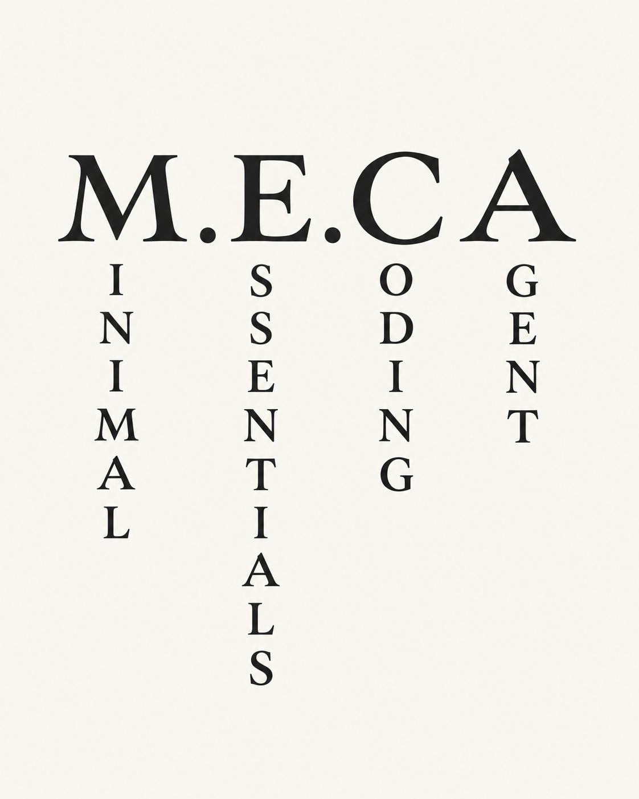

<div align="center">



*A coding agent with just the essentials.*

[설치](#설치) · [사용법](#사용법) · [Program Philosophy](#program-philosophy) · [설정](#설정) · [문서](#문서)

</div>

**M.E.CA — Minimal Essentials Coding Agent**는 필요한 기능만 담은 터미널 코딩 에이전트입니다. 모델을 연결하고, 자연어로 코드 작성·수정·검증을 요청하세요.

- Ollama, vLLM, SGLang, LM Studio, LiteLLM, OpenRouter 연결
- 스트리밍 응답·Thinking, Markdown과 줄 단위 diff
- 파일·셸 도구, 오래 실행되는 명령의 조회·대기·취소
- 로컬 대화 저장·압축·재개, 작업 중 방향 수정과 후속 요청 예약
- 실제 입력·출력 토큰·TPS, OpenRouter의 보고 비용 표시

## 설치

Linux·WSL과 macOS의 amd64·arm64를 지원합니다. 릴리스 바이너리는 Go 설치 없이 사용할 수 있습니다.

### 최신 릴리스로 설치하기

1. [최신 릴리스](https://github.com/keonho-kim/m.e.ca/releases/latest)에서 운영체제와 CPU에 맞는 `.tar.gz` 파일을 받습니다.
2. 압축을 풀고 터미널에서 압축을 푼 폴더로 이동합니다.
3. 아래 명령으로 설치합니다.

```sh
./meca install
```

설치 후 터미널에서 `meca`를 실행하면 됩니다.

<details>
<summary>설치 상세 안내 — 파일 선택·체크섬·업데이트·소스 빌드·삭제</summary>

### 운영체제와 CPU에 맞는 파일 선택

| 환경 | 파일명의 `<platform>` |
| --- | --- |
| Apple Silicon Mac | `macos_arm64` |
| Intel Mac | `macos_amd64` |
| Linux·WSL — `x86_64` | `linux_amd64` |
| Linux — `aarch64`·`arm64` | `linux_arm64` |

Linux의 CPU 종류는 `uname -m`으로 확인할 수 있습니다.

### 터미널에서 압축 해제하기

다운로드한 폴더에서 실행합니다. `<version>`과 `<platform>`은 받은 파일명으로 바꾸세요.

```sh
mkdir meca-install
tar -xzf "meca_<version>_<platform>.tar.gz" -C meca-install
./meca-install/meca install
```

`~/.local/bin/meca`에 설치하고 필요한 PATH를 등록합니다. 설정·프롬프트·대화는 `~/.meca`에 저장합니다.

### 체크섬 확인 (선택)

파일의 무결성을 확인하려면 같은 릴리스의 `checksums.txt`도 다운로드합니다. 압축을 풀기 전에 아래 명령의 결과를 `checksums.txt`의 동일 파일명 항목과 비교하세요.

```sh
# macOS
shasum -a 256 "meca_<version>_<platform>.tar.gz"

# Linux
sha256sum "meca_<version>_<platform>.tar.gz"
```

### 업데이트

실행 중인 MECA를 종료한 뒤 실행합니다.

```sh
meca upgrade
```

최신 릴리스를 내려받아 검증하고 설치합니다. 설정·모델 연결·대화는 유지하며, 프롬프트 세 파일은 배포 기본본으로 갱신합니다.

### 소스에서 설치하기

Git·curl·tar와 `sha256sum` 또는 `shasum`이 필요합니다. Go가 없으면 빌드용으로 임시 다운로드합니다.

```sh
git clone https://github.com/keonho-kim/m.e.ca.git
cd m.e.ca
./install.sh
```

최신 소스로 재설치하려면 저장소에서 실행합니다.

```sh
git pull --ff-only
./install.sh
```

### 빌드만 하기

Go 1.27.2 이상에서 실행합니다.

```sh
go build -tags=godbus_no_tcp -trimpath -o bin/meca ./cmd/meca
```

설치하려면 `./bin/meca install`을 실행합니다. 공식 빌드와 소스 설치에도 같은 [DBus 전송 정책](docs/configuration.md#linux-자격-증명-전송)을 적용합니다.

### 삭제

```sh
meca uninstall
```

설치한 명령·PATH 등록·`~/.meca` 전체와 MECA가 저장한 OS 인증정보를 삭제합니다. 사용자 프로젝트는 유지합니다.

[설치 옵션·체크섬·업데이트 상세 →](docs/releases.md)

</details>

## 사용법

```sh
meca                  # 현재 프로젝트에서 시작
meca /path/to/project  # 지정한 프로젝트에서 시작
meca resume           # 모든 프로젝트의 이전 대화에서 선택
```

1. `!model`에서 Provider·서버 주소·API Key·모델을 설정합니다. [모델 연결 가이드](docs/model-connections.md)를 참고하세요.
2. 자연어로 작업을 요청합니다. 파일을 참조하려면 `!dir`에서 선택합니다.
3. 응답·도구 결과·diff를 확인하고, 필요하면 작업 중 방향을 수정하거나 중지합니다.

| 명령 | 기능 |
| --- | --- |
| `!model` | 연결·모델·Thinking·추론 강도 설정 |
| `!language` | 화면 언어 선택 |
| `!permission` | 기본 / All Mighty 승인 모드 선택 |
| `!dir [path]` | 파일 탐색·Markdown/Raw 뷰어·요청에 파일 참조 |
| `!new` | 현재 프로젝트에서 새 대화 시작 |
| `!quit` | 작업을 정리하고 종료 |

`!` 뒤에 글자를 입력하면 명령을 검색합니다. 설정 저장·파일 전송 확인에서는 `y`·`Y`로 진행하고, 대문자 `N`으로 취소합니다. 소문자 `n`은 무시합니다.

| 조작 | 동작 |
| --- | --- |
| `Enter` / `Shift+Enter` | 요청 전송 / 줄바꿈 |
| 작업 중 `Enter` / `Tab` | 다음 판단에 방향 수정 / 완료 후 수행할 요청 예약 |
| `Shift+↑/←` | 마지막 예약 열기·이전 예약 선택 |
| 큐 편집 중 `Shift+↓/→` | 다음 예약 선택 |
| 큐 편집 중 `Enter`·`Tab` / `Esc` | 수정 저장 / 편집 취소 |
| 큐 편집 중 `Ctrl/Cmd+Backspace` | 선택한 예약 삭제 |
| `Esc` | 열린 화면·편집 닫기, 일반 채팅에서는 작업 중지 |
| `Ctrl+O` | 도구 결과 전체 접기·펼치기 |
| 파일 뷰어 `Shift+R` | Markdown 렌더링 / Raw 원문 전환 |
| 선택 후 `Ctrl/Cmd+C` | 복사 · 선택 없는 `Ctrl+C`는 종료 |

후속 요청은 예약 순서대로 실행합니다. 중지·실패 시 남은 요청은 초안으로 복구합니다. [전체 키맵·파일 탐색·사용량 →](docs/usage.md)

### 승인과 실행 범위

기본 모드는 일반 작업을 자동 실행하고 위험 작업에 승인을 요청합니다. All Mighty는 그 외 승인 대상을 자동 승인하지만, **외부 전송은 모든 모드에서 매번 직접 승인**받습니다. 승인할 수 없는 비대화형 실행에서는 외부 전송을 중단합니다.

프로젝트는 기본 작업 위치이며 OS 격리 경계가 아닙니다. 명령은 호스트 사용자 권한으로 실행합니다. [검사 대상과 보장 범위 →](docs/execution-boundary.md)

### 터미널 없이 실행하기

`!model`에서 연결을 저장한 뒤 사용할 수 있습니다.

```sh
meca --print "README를 검토해줘"
meca /path/to/project --mode json "요청한 파일을 만들어줘"
git diff | meca --print "이 변경을 검토해줘"
meca --diagnose
```

print는 최종 답변, JSON 모드는 순서 있는 이벤트를 출력합니다. [세션 재개·내보내기 →](docs/usage.md#도구-결과와-markdown)

## Program Philosophy

M.E.CA는 미니멀함과 가벼움을 설계의 기준으로 삼습니다.

- **Only the essentials.** 모델 연결, 파일·셸 도구, 이어갈 수 있는 대화. 메인 에이전트 하나가 직접 작업합니다.
- **Lightweight by construction.** 하나의 Go 실행 파일과 사용자의 터미널·개발 도구를 활용합니다.
- **Stay in your flow.** 요청·응답·변경 확인을 터미널 안에서 이어갑니다.
- **Private by design.** **Your code. Your model. Your control.** 사용할 모델과 데이터를 사용자가 선택합니다.

별도 MECA 계정이나 중앙 대화 서버를 사용하지 않습니다. 추론까지 로컬에서 처리하려면 Ollama·LM Studio 같은 로컬 서버를 연결하세요. 원격 모델을 선택하면 프롬프트·대화·작업에 포함된 코드와 도구 결과가 해당 서버로 전송됩니다. OpenRouter에는 실제 추론 공급자의 처리 정책도 적용됩니다.

## 설정

첫 실행에서 기본 파일을 생성합니다.

```text
~/.meca/
├── config.toml
├── prompts/
├── sessions/
└── logs/
```

화면 언어는 `!language`, 모델은 `!model`, 승인 모드는 `!permission`에서 설정합니다. API Key는 macOS Keychain 또는 Linux Secret Service에 보관합니다. 역할별 추론 인자·출력 예산·대화 압축은 [설정 가이드](docs/configuration.md)를 따릅니다.

## 개발

```sh
GOFLAGS='-tags=godbus_no_tcp' go test ./...
GOFLAGS='-tags=godbus_no_tcp' go vet ./...
```

[개발 가이드](docs/development.md)에서 패키지 구성·개발 도구·플랫폼 검증을, [릴리스 가이드](docs/releases.md)에서 배포 절차를 확인할 수 있습니다.

## 기여 정책

개인이 단독 개발·관리하며 외부 코드 기여는 받지 않습니다. 버그 제보와 기능 제안은 [GitHub Issues](https://github.com/keonho-kim/m.e.ca/issues)로 받습니다. [기여 정책 →](CONTRIBUTING.md)

## 라이선스

[Apache License 2.0](LICENSE)을 따릅니다. [저작권 고지](NOTICE) · [외부 소프트웨어 고지](THIRD_PARTY_NOTICES.md)

## 문서

| 문서 | 내용 |
| --- | --- |
| [사용 가이드](docs/usage.md) | 키맵·파일 탐색·예약·승인·사용량 |
| [모델 연결](docs/model-connections.md) | Provider·Thinking·서빙 설정·연결 진단 |
| [설정과 대화 보존](docs/configuration.md) | 추론 인자·프롬프트·Compaction·세션 |
| [에이전트 작동 방식](docs/runtime.md) | 모델 요청·도구·명령 수명·재개 |
| [실행 경계](docs/execution-boundary.md) | 호스트 권한·파일 검사·외부 전송 승인 |
| [개발 가이드](docs/development.md) | 패키지 구성·검증·성능 측정 |
| [릴리스 가이드](docs/releases.md) | 설치 상세·배포 파일·날짜 버전·게시 |
| [제품 명세](SYSTEM.md) | 요구사항과 아키텍처 |
