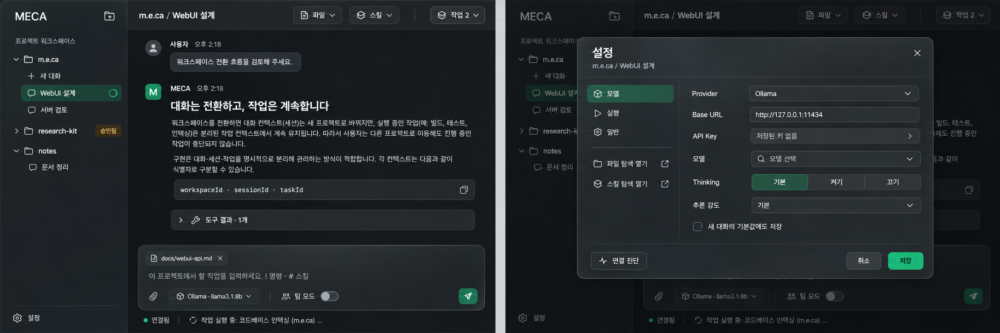

# 내장 WebUI 구조와 디자인

[서버 계약](server.md) · [화면별 API 연결](webui-api.md) · [제품 명세](../SYSTEM.md)

full 배포본의 `meca --server --ui`는 기존 Go 서버와 같은 출처의 `/ui/`에서 React 작업공간을 제공한다. full 바이너리에 화면을 내장하며 minimum에는 서버·WebUI를 포함하지 않는다. 사용자의 실행 환경에는 Bun·Node·별도 프론트 서버가 필요 없다. 정적 파일의 소스는 `webui/`, 내장·전송은 `internal/webui`, 조립은 `cmd/meca`가 소유한다.

프론트 소스는 FSD 계층과 슬라이스의 공개 API를 따른다. 앱 조립은 `app`, 화면과 화면 전용 흐름은 `pages`, 여러 화면이 공유하는 인증 동작은 `features`, 서버 세션은 `entities`, 공통 기반은 `shared`에 둔다. 계층 방향과 공개 진입점은 Steiger로 검증한다. 구체적인 소유권은 [개발 가이드](development.md#내장-webui)를 따른다.

위 그림은 방향 검토를 위한 AI 생성 시안이다. 실제 Astryx 컴포넌트의 렌더링 결과나 제품 데이터가 아니며, 구현된 화면·동작은 아래 설명과 소스가 소유한다.

## 화면과 이동

좌측에는 접을 수 있는 작업공간별 대화 목록을 둔다. 시작 프로젝트를 기본 작업공간으로 등록하고, 폴더 추가로 서버 파일시스템의 다른 프로젝트를 등록한다. 서버와 다른 컴퓨터의 브라우저에서도 폴더 선택은 서버의 폴더를 뜻한다.

| 영역 | 구성 |
| --- | --- |
| 접속 | 서버 토큰 입력, 인증 실패 안내. 원문 토큰은 저장하지 않고 서버가 발급한 HttpOnly 쿠키로 접속 |
| 탐색 | 작업공간 펼침·접기, 페이지별 대화 목록, 새 대화, 대화 삭제, 실행 수와 승인 표시 |
| 대화 | 가상화한 저장 이력, Markdown·코드·Thinking, 발신자별 팀 응답, 도구·스킬·진행 상태와 원문 조회 |
| 컴포저 | 본문, 이미지 붙여넣기·파일 첨부, 저장 참조, 명령·스킬 후보, 방향 수정·후속 예약·작업 중지 |
| 파일 | 컬럼 탐색, 참조 체크박스, Markdown/raw 페이지, 기본 텍스트 편집·문법 강조·충돌 확인 |
| 스킬 | 목록·설명·출처·진단, SKILL.md와 참고 파일 읽기, 현재 입력에 명시 호출 삽입 |
| 작업 | 프로젝트별 작업 기록, 소유 대화 이동, 취소, 실제 실행 명령의 상태·경과 시간 조회 |
| 설정 | 좌측 하단 톱니바퀴로 여는 단일 모달. 모델·실행·일반과 파일·스킬 바로가기 |
| 승인·원문 | 실제 작업·대상·미리보기·만료를 표시하고 승인/거절. 큰 원문은 revision에 묶인 페이지로 조회 |

`/ui/w/{workspaceId}/c/{sessionId}`가 표시 대상을 식별한다. 다른 대화로 이동하거나 스트림 표시를 일시정지해도 접수한 작업은 서버에서 계속된다. 현재 대화의 입력과 예약은 다른 작업공간의 입력과 섞지 않는다. 대화를 전환할 때 현재 대화의 스크롤 위치를 제한적으로 보관한다.

## 명령과 설정

컴포저 명령과 UI 버튼은 같은 동작을 호출한다. 명령 해석과 카탈로그는 기존 Go 명령 패키지가 소유한다. `!new`·`!quit`·`:q`는 브라우저 명령으로 지원하지 않으며 모델에 넘기지 않는다.

| 명령 | UI 접근 | 적용 범위 |
| --- | --- | --- |
| `!model` | 설정 → 모델 | 현재 대화. 선택 시 새 대화 기본값도 저장 |
| `!permission` | 설정 → 실행 → 승인 모드 | 모든 작업공간. 실행 중 변경 거절 |
| `!team` | 컴포저 팀 모드 / 설정 → 실행 | 현재 대화의 다음 요청부터 |
| `!language` | 설정 → 일반 → 언어 | 전역 UI 언어 |
| `!dir [path]` | 헤더 파일 / 설정 바로가기 | 현재 작업공간 탐색과 대화의 참조 선택 |
| `!skills` | 헤더 스킬 / 설정 바로가기 | 사용 가능한 스킬 조회와 입력에 호출 삽입 |

모델 폼은 Provider·Base URL·API Key·모델 ID·Thinking·추론 강도·기본값 저장 여부를 다룬다. 조회·진단·저장은 각각 명시적인 버튼이다. 저장된 키의 원문을 폼에 복원하지 않는다. 저장 중에는 모달을 닫아 변경을 버린 것처럼 보이게 하지 않는다. 언어·승인 모드의 전역 범위와 팀 모드의 현재 대화 범위를 표시한다.

설정 항목은 넓은 화면에서는 좌측 목록으로 표시하고 640px 이하에서는 상단 Selector로 전환한다. 모델 폼의 폭을 우선하며 화면 크기 변경으로 편집 중인 폼을 다시 마운트하지 않는다. 반응형 미디어 구독도 Astryx가 소유한다.

컴포저에는 모델 선택과 음성 입력을 두지 않는다. `+`는 열릴 때 90도 회전하고 Astryx ChatComposerDrawer가 입력 위로 펼쳐진다. 안에는 스킬 목록으로 이동하는 버튼과 이미지 전용 FileInput을 둔다. Escape·선택 완료로 닫고 입력으로 포커스를 돌린다. 닫힌 패널은 키보드 탐색에서 제외한다.

이미지는 컴포저 전체 드래그 앤 드롭, 입력창의 일반 붙여넣기, `Alt+V`와 macOS `Ctrl+V`로도 추가한다. 모든 경로가 같은 개수·파일 크기·합계 크기와 전역 초안 예산을 검사하며 파일 드롭을 중복 처리하지 않는다. 일반 Ctrl/Cmd+V의 텍스트·이미지 붙여넣기는 Astryx 입력창이 처리한다. 명시 단축키의 이미지 읽기는 브라우저 Clipboard API와 해당 권한·보안 컨텍스트가 필요하며 사용할 수 없으면 +로 선택할 수 있도록 안내한다. 읽기 중 대화 변경·컴포저 종료가 발생하면 늦게 도착한 결과를 버린다.

Enter는 전송, Shift+Enter는 줄바꿈, Ctrl/Cmd+Enter는 후속 예약이다. 명령/스킬 후보가 열려 있으면 Enter/Tab은 먼저 후보를 입력한다. IME 조합 중 Enter는 제출하지 않는다. 일반 텍스트는 실행 중 작업의 방향 수정으로 보내고, 이미지 또는 명시한 예약은 다음 독립 요청으로 보관한다.

## 상태·동시성·저장 책임

서버가 작업·승인·대화·모델 연결·저장을 소유한다. `--concurrency`는 프로세스 전체 작업공간에 적용한다. 같은 세션은 한 번에 하나의 작업만 쓰며, 파일 변경과 임의 셸 효과는 프로세스 공통 게이트를 사용한다. 작업공간이 달라도 셸이나 절대 경로가 같은 파일에 접근할 수 있으므로 폴더 이름만으로 잠금을 분리하지 않는다.

브라우저의 Zustand는 서버 인증 상태, 브라우저 테마 설정, 워크스페이스의 미전송 입력·후속 예약·작은 live 표시·화면 상태를 소유권별로 분리한다. 서버 데이터는 TanStack Query가 소유한다. 캐시와 초안 키에 작업공간·대화를 포함하고, 전체 대화 화면을 숨겨 둔 채 계속 마운트하지 않는다. 테마만 localStorage에 저장하며 대화·키·첨부를 브라우저 영속 저장소에 복제하지 않는다. 같은 입력의 반복 반영은 revision을 변경하지 않으며 명시적인 연결 종료는 편집기를 포함한 워크스페이스 수명을 끝낸다.

후속 예약은 브라우저가 열려 있어야 실행된다. 선행 작업의 실제 outcome이 completed이고 오류가 없는 경우에만 다음 요청을 접수한다. 중지·실패·저장 불확실·성공 여부를 확인할 수 없는 복원은 예약을 멈추고 사용자의 계속 실행을 기다린다. 단순히 답변을 저장했다는 task.status만으로 성공을 추정하지 않는다. 대기 요청을 편집하는 동안 자동 접수를 보류한다.

요청마다 안정된 키를 보관하고 응답을 잃으면 `lookupRequest`로 원래 요청을 조회한다. 완료 이벤트가 시작 응답보다 먼저 도착해도 종료 상태를 실행 중으로 되돌리지 않는다. 확인되지 않은 요청에 새 키를 붙여 부작용을 재실행하지 않는다.

SSE는 프로세스 공통 이벤트 로그를 관찰한다. 보이지 않는 대화의 토큰은 보관하지 않고 실행·승인 등 메타데이터만 반영한다. 선택 대화의 작은 snapshot과 커서에서 재연결하고, 로그 만료 시 snapshot·history로 복구한다. 완료 초안은 저장 이력을 받은 뒤 제거해 화면 깜빡임을 막는다. 서버 heartbeat는 데이터가 5초간 없으면 1초마다 전송한다. SSE comment heartbeat는 JavaScript 메시지 이벤트를 발생시키지 않으므로 애플리케이션 메시지의 침묵으로 정상 연결을 끊지 않는다. 연결 상태는 하단 한 곳에 표시하며 모델 서버가 아닌 MECA 이벤트 연결을 뜻한다. 일시정지와 최초 연결·복구 중을 구분한다.

## 파일·콘텐츠 안전성

`!dir`는 서버 폴더의 탐색과 참조 선택이다. 작업공간의 프로젝트 루트를 바꾸지 않는다. 참조는 서버에 저장한 후 요청에 캡처한다. 파일을 탐색하면서도 컴포저를 사용할 수 있다.

미리보기와 편집은 다른 계약이다. 편집은 전체 UTF-8 문서와 revision을 받아야 하며, 마스킹·바이너리·크기 초과 파일은 읽기 전용이다. 저장은 현재 원본을 다시 검사한 뒤 같은 디렉터리에서 원자적으로 교체한다. 충돌 시 현재 파일과 미저장 편집을 보존하며 자동 덮어쓰기를 하지 않는다. 저장 중 추가로 편집한 내용은 저장 완료 뒤에도 미저장 상태다. 편집 표면은 Astryx Lab CodeEditor가 소유하며 문법 강조·줄 번호·기본 텍스트 편집을 제공한다.

파일 감시는 활성 디렉터리 하나를 관찰하고 변경 알림을 합친다. 폴더 변경이 현재 파일의 변경을 보장하지는 않으며 저장의 revision 검사로 최종 확인한다. 창 전환·종료·인증 만료 시 관찰 연결과 읽기 요청을 정리한다. 인증 갱신 중에는 작업 영역을 숨기고 편집 초안을 유지한다.

Markdown은 Astryx의 안전한 렌더러를 사용한다. 원격 이미지를 자동으로 요청하지 않고 링크로 표시하며 실행 가능한 링크 스킴을 허용하지 않는다. 저장된 첨부는 인증한 프로젝트별 이미지 URL로 조회한다. 원문은 페이지 단위로 읽고 revision이 다른 페이지를 합치지 않는다.

답변과 Thinking은 모두 스트리밍 Markdown으로 렌더링한다. Thinking은 기본 펼침이며 회색 secondary 텍스트로 본문과 구분하되 라이트·다크에서 읽기 대비를 유지한다. 저장 이력으로 바뀐 뒤에도 같은 표현을 사용한다. 완료·실행 정보는 ChatSystemMessage·ChatMessageMetadata, 도구 상태는 ChatToolCalls, 제출은 ChatSendButton을 사용한다.

## 시각 체계

기본 작업 모드는 Operate다. 넓은 읽기 영역, 조용한 좌측 탐색, 항상 접근할 수 있는 입력을 우선한다. 장식용 카드나 지표 대시보드로 대화 화면을 채우지 않는다.

- 기본은 라이트 테마다. 흑백 중심의 중성 표면·주요 동작·선택 상태와 Apple 스타일의 얇은 글래스 재질을 사용한다. 다크에서도 같은 정보 위계와 재질을 유지한다. 좌측 하단에서 즉시 전환하거나 설정에서 라이트·다크·시스템을 선택하며, 저장한 선택을 우선한다. 시스템 설정은 최상위에서 실제 테마로 해석해 Astryx에 적용한다.
- 색은 실행·연결·완료·승인·실패 상태를 구분하는 데 사용한다. 연결·완료는 success, 승인·중단은 warning, 실패는 error의 공식 의미 토큰을 따른다. 팀 선택은 ToggleButton의 눌림 상태와 접근성 정보를 사용한다. 코드 문법 색은 의미 구분을 위해 별도로 유지한다.
- 반투명 재질은 고정 헤더·컴포저·모달처럼 아래 콘텐츠와 겹치는 표면에 사용한다. blur를 지원하지 않으면 불투명 표면을 쓴다.
- 글꼴은 운영체제와 한글 기본 글꼴이다. 코드·경로·정량 정보에만 monospace를 사용하며 외부 폰트를 로드하지 않는다.
- 의미 있는 제목·버튼·레이블, 키보드 포커스, 실제 모달 focus 소유권을 유지한다. 선택과 실행 상태는 색 이외의 텍스트·모양으로도 구분한다.
- Astryx Button·IconButton·TabList·SegmentedControl·Switch·Badge·Tooltip·Skeleton·Spinner·TextInput·FormLayout·Markdown·CodeBlock을 사용한다. Dialog·AlertDialog·Drawer·Lightbox가 각각의 focus·Escape·표시 수명을 소유한다.
- Skeleton은 아직 구조를 조회하는 부분에만 사용한다. 대화 목록은 Astryx shimmer, 이력은 pulse로 표시하며 크기를 알 수 없는 로딩에는 Spinner를 사용한다. 기존 이력을 재검증할 때 전체 화면을 skeleton으로 교체하지 않는다.
- 탐색·탭·모달·drawer·명령 후보의 관계는 Astryx의 기본 선택·펼침·진입 동작으로 보여준다. 첨부 패널은 + 회전과 위쪽 아코디언 펼침을 결합한다. 응답 토큰마다 애니메이션을 재시작하지 않는다. reduced-motion 처리는 공식 적응 규칙을 따르며 추가한 회전·펼침 전환도 즉시 반영한다.
- 좁은 화면에서는 좌측 탐색을 drawer로 바꾸고 본문·설정·파일 영역의 폭을 줄인다. 데스크톱의 정보 구조는 유지한다.

모든 UI 조작과 표면은 Astryx 컴포넌트로 구성한다. 색·재질·모션과 reduced-motion 예외는 `webui/src/app/styles/theme.ts`의 공식 테마 확장 계약이 소유한다. 배치는 AppShell·Layout·SideNav, 설정은 Dialog·Selector·FormLayout, 작업과 원문은 Drawer를 사용한다. ChatLayout·ChatMessageList·ChatMessageBubble·ChatTokenizedText·ChatToolCalls·ChatComposerDrawer와 입력·전송·상태 컴포넌트가 대화 표현을 소유한다. 애플리케이션은 실행 계약과 가상화 좌표만 결합하며 위젯 내부 DOM을 CSS로 덮어쓰지 않는다. Astryx 공식 CSS와 Tailwind bridge를 사용하며 실제 패키지 소스를 수정하지 않는다.

CodeEditor의 현재 배포 조건에 맞춰 Core·Neutral·Lab·CLI를 동일한 `0.7.12-canary.f124c2f`로 고정한다. canary 조합이므로 갱신 시 타입·빌드·실제 브라우저 계약을 함께 검증한다. 생성한 테마 모듈·CSS는 Git에 넣지 않고 check와 build가 소스 descriptor에서 생성한다.

## 빌드·자원·검증

Bun·TypeScript·Vite가 정적 SPA를 빌드하고 content hash별 gzip 한 사본과 manifest를 만든다. Go는 파일을 실행 파일에서 직접 제공한다. 시작 시 전체 자산을 압축 해제하거나 디스크에 풀지 않는다. index는 재검증하며 해시 자산은 immutable 캐시를 사용한다. 전체 UI가 빠진 Go 소스 빌드는 `--ui`에서 명시적으로 실패한다.

인증 화면 다음에 작업공간을 읽고 대화 본문·설정·파일·스킬·에디터와 언어 지원은 필요한 시점에 읽는다. Lab CSS는 에디터 청크에 결합한다. Next.js·Hono·htmx·별도 JavaScript 서버를 사용하지 않는다. HTTP는 native fetch이며 React Hook Form·Zod·resolvers는 모델 폼에 사용한다.

브라우저의 보관 예산과 서버의 저장·실행 예산은 구분한다. live 텍스트는 소스별 표시 창과 전체 상한을 두고, 비활성 대화 캐시는 최근 일부만 유지한다. 서버 작업공간 런타임도 사용 중인 자원과 기본 작업공간을 제외하고 최근 idle 네 개를 보관한다. 구체적인 한도·검증 명령은 [개발 가이드](development.md#내장-webui)와 [서버 자원 한도](server.md#이벤트재접속수명)를 따른다.

검증에는 타입 검사·순수 상태/요청 테스트·Go 어댑터/잠금 테스트와 실제 브라우저를 함께 사용한다. 브라우저 검증은 [Playwright CLI](../webui/package.json)의 로컬 실행과 격리된 provider fixture를 사용하며 실제 API Key·유료 모델·사용자 프로젝트를 요구하지 않는다.
